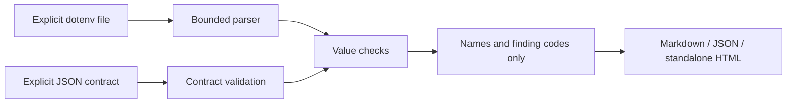

# Env Contract

**离线检查环境变量配置，在启动前发现缺失项、类型错误和拼写遗漏。报告不输出配置值。**

**Offline dotenv contract validation.** Catch missing variables, invalid types,
out-of-range settings and unexpected names before starting your application.
Reports omit values. No runtime dependencies, network, telemetry or subprocesses.

## 快速开始 / Quickstart

Requires Node.js **22+** and npm. From this source directory:

```sh
npm ci --ignore-scripts
npm run build
node dist/cli.js --help
node dist/cli.js check --contract examples/contract.json --dotenv examples/valid.env
node dist/cli.js check --contract examples/contract.json --dotenv examples/invalid.env --fail-on none
npm test
```

To install the built command from the source checkout:

```sh
npm install --global . --ignore-scripts
envcontract --version
```

Package name: `env-contract-cli`; executable: `envcontract`. The quickstart uses
local source and does not assume an npm registry publication. Quote paths with
spaces on Windows, for example `--dotenv "C:\My App\settings.env"`.

## 从示例开始 / Start with an example

```sh
envcontract init --example .env.example --output env.contract.json
envcontract check --contract env.contract.json --dotenv .env
```

`init` copies **variable names only** and marks each as a required string. Example
values are never copied. Edit the generated contract to declare types and limits.
It will not replace an existing contract file.

## Contract v1

```json
{
  "schemaVersion": 1,
  "additionalVariables": "warn",
  "variables": {
    "APP_PORT": { "type": "integer", "minimum": 1, "maximum": 65535 },
    "DEBUG": { "type": "boolean" },
    "API_URL": { "type": "url", "protocols": ["https:"] },
    "API_TOKEN": { "minLength": 12 },
    "MODE": { "enum": ["development", "production"] },
    "LABEL": { "required": false, "allowEmpty": true }
  }
}
```

| Option | Behavior |
| --- | --- |
| `type` | `string` (default), `integer`, `number`, `boolean`, `url` |
| `required` | Missing variable is an error; default `true` |
| `allowEmpty` | Permit an empty value and skip further value constraints; default `false` |
| `minimum`, `maximum` | Finite bounds for integer/number types |
| `minLength`, `maxLength` | Unicode code-point length for string/url types |
| `enum` | Exact allowed string choices; case sensitive |
| `protocols` | Allowed URL protocols ending in `:`; default HTTP/HTTPS |
| `additionalVariables` | Top-level policy: `warn` (default), `error`, `ignore` |

Integer values must be safe integers; numeric values must be finite decimal
numbers. Boolean values are `true`, `false`, `1`, `0` (words ignore case). URLs
must be absolute and have a hostname. Database protocols such as `postgresql:`
can be explicitly listed. Unknown properties and inconsistent bounds are rejected.

Variable names use ASCII letters, digits and underscores, cannot start with a
digit, and are case sensitive. Contracts are a small versioned format; advanced
JSON Schema features, conditional rules and user regular expressions are outside
this release.

Contract files reject duplicate JSON properties, including keys that become
identical after JSON escape decoding. JSON nesting is limited to 128 levels.
This prevents a later duplicate from silently overriding an earlier rule.

## 报告与 CI / Reports and CI

```sh
envcontract check --contract env.contract.json --dotenv .env --format json
envcontract check --contract env.contract.json --dotenv .env --format html --output review.html
envcontract check --contract env.contract.json --dotenv .env --fail-on warning
```

Options use separate arguments. Default output is Markdown on stdout.
`--output` exclusively creates a new file; choose a new filename on repeated runs.

| Exit | Meaning |
| --- | --- |
| `0` | Report generated; selected threshold not crossed |
| `1` | Usage, parsing, contract, encoding, size or file I/O failure |
| `2` | Report generated; selected threshold crossed |

Default `--fail-on error` gates error findings. `warning` also gates warnings;
`none` emits the report and exits 0 when input processing succeeds. Summary error
and warning counts refer to findings, while `valid` counts variables.

See the committed [HTML report](examples/report.html) and [Markdown report](examples/report.md)
for the synthetic invalid example. Neither contains the input values or enum choices.

## Dotenv 支持范围 / Dotenv syntax

- UTF-8 with optional BOM; CRLF/LF, comments, whitespace, optional `export`.
- Unquoted, single-quoted, double-quoted and multiline quoted values.
- Single quotes preserve contents. Double quotes support `\n`, `\r`, `\t`, `\\`,
  `\"`; unknown escapes retain their backslash.
- Duplicate names, malformed assignments, unmatched quotes, trailing text after
  quoted values and NUL characters are errors with line numbers only.
- No `${...}` expansion, shell substitution, file imports or environment fallback.
  Variable text is data, including text named `NODE_OPTIONS`.

Use the supported **`--dotenv`** argument. Node's own `--env-file` option can load
variables before the application starts on some runtimes; it is not an Env Contract
option. For a source invocation with an explicit Node option separator, use
`node -- dist/cli.js check --contract contract.json --dotenv settings.env`.

Input limits: regular files only, 1 MiB per file, 10000 dotenv lines, 2000 variables,
64 KiB per dotenv value. No compressed files, stdin, directory scanning or automatic
home/project discovery. [Node's dotenv documentation](https://nodejs.org/api/environment_variables.html)
is the reference for names/comments/quoting; this tool's supported subset and
escape behavior are documented above.

## 隐私与边界 / Privacy and boundaries

Reports contain names, statuses, finding codes and line numbers. They omit actual
values, enum choices, input paths and raw parser errors. `init` never copies example
values. Report generation and checking do not change the dotenv input file.

**Names can still be sensitive.** Do not put secrets in variable names and review
reports before sharing. This tool does not detect all secrets, encrypt files,
verify application behavior, contact services or modify/deploy an application.
The installed Node.js runtime, its preloads and the local filesystem are trusted.

HTML is standalone, with escaped text, no scripts/external assets and a restrictive
CSP. Identical inputs produce identical output; JSON report schemaVersion is 1.

## 架构 / Architecture



`dotenv.ts` parses bindings; `contract.ts` validates rules and generates name-only
contracts; `check.ts` produces findings; `render.ts` formats safe reports; `io.ts`
bounds file reads and protects output; `cli.ts` maps options/errors/exit codes.

## 开发与贡献 / Development

```sh
npm ci --ignore-scripts
npm test
npm run build
npm run check:security
npm run check:package
```

Tests use synthetic inputs and real CLI processes. The package gate installs the
tarball offline and invokes the installed executable. CI covers Linux, Windows
and macOS. Development dependency installation and GitHub publication use network;
checking configuration does not.

See [CONTRIBUTING.md](CONTRIBUTING.md), [AGENTS.md](AGENTS.md), [SECURITY.md](SECURITY.md)
and the [90-day plan](docs/maintenance-plan.md). 中文反馈欢迎。

## License

[MIT](LICENSE), Copyright (c) 2026 Env Contract contributors.
